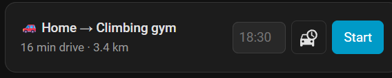
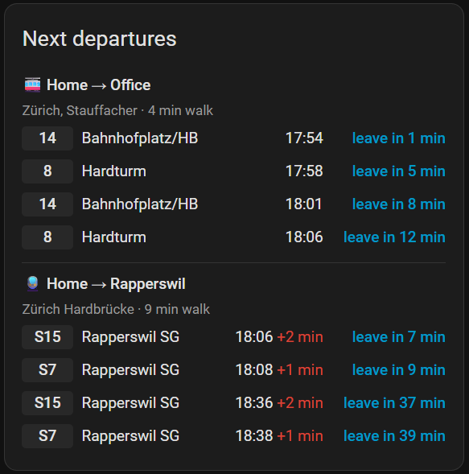
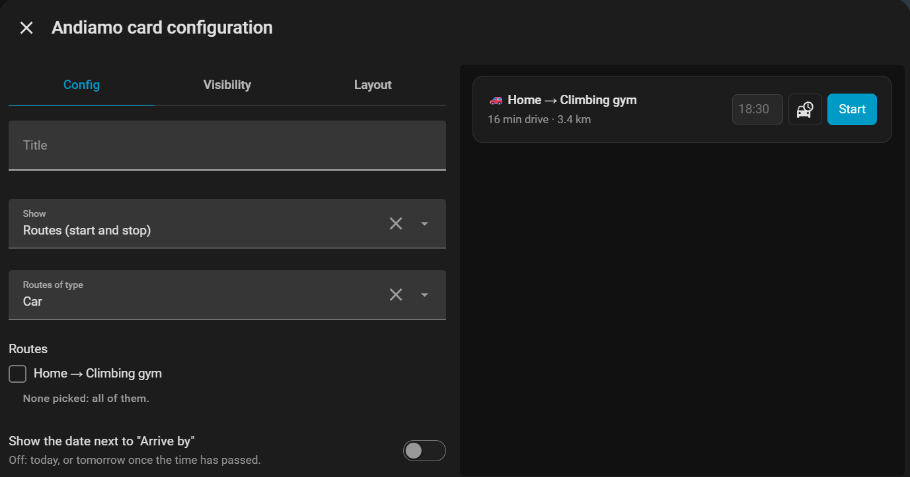

# Andiamo

**Never miss your train, bus or tram again, and stop checking the time while you get ready.**

Andiamo (Italian for *"let's go!"*) is a Home Assistant integration that tells you, out loud on your speaker, exactly when to leave the house: to catch your bus, tram or train, or to arrive somewhere by car on time.

- **Public transport (Switzerland):** press one button and your speaker says *"You need to leave at 10:15, that is in 7 minutes."*, then *"2 minutes left"* and *"Go now!"*. Andiamo knows how long you walk to your stop and which lines you take, follows real-time delays, and announces a new time if yours moves. Too late for the next train, bus or tram? It quietly picks the one after. Press again to cancel.
- **Car:** set "arrive by 19:00" on the dashboard card. From 30 minutes before you need to leave, the speaker counts down every 5 minutes (*"You have 25 minutes left"*) and ends with *"Go now!"*. Live traffic is followed all the way, so a jam on the way means an earlier "go". Need a few minutes for parking? Add a **reserve**: with a 30-minute drive and 10 minutes reserve, Andiamo plans 40 minutes.

Everything is set up on one sidebar page, no YAML. Announcements are in German (default) or English.

**Where it works:** car routes work anywhere TomTom has maps. Public transport uses Swiss data (opentransportdata.swiss), so it only covers Switzerland for now. Other free transport data providers can be added: [open an issue](https://github.com/geeForceOne/andiamo/issues) and say which one you'd like.

## Screenshots

**Routes:** one tap to start. The watchdog flags a cancelled tram; the open car route is watched on weekday evenings (alert from 10 minutes of traffic) and weekend mornings (from 15).


**Places and stations:** each place has its stations with the walking time; the search shows what stops there, so the train station is easy to tell from the tram stop outside.


**Settings:** speaker, language, where announcements go, the daily API limits, and your own announcement texts. The line under the tabs shows today's API calls.


**Dashboard card:** start routes, set "arrive by" for the car, check the drive time right now (car-and-clock button), and see watchdog problems. Without the date, the car row stays on one line.




**Timetable:** the next departures on your lines, with delays and when to leave, counting the walk to the station.



**Card editor:** set the card up without YAML.



## What you need

- Home Assistant 2026.3 or newer.
- For public transport: a free API key from [opentransportdata.swiss](https://api-manager.opentransportdata.swiss/) (OJP 2.0).
- For the car: a free API key from [TomTom](https://developer.tomtom.com/) (Routing and Search).
- A text-to-speech entity (e.g. Google Translate, Piper) and a speaker (`media_player`).

## Install

Andiamo is in the default HACS list.

**HACS, the quick way:** click this button. It opens Andiamo in HACS in your Home Assistant; click **Download**, then restart Home Assistant.

[](https://my.home-assistant.io/redirect/hacs_repository/?owner=geeForceOne&repository=andiamo&category=integration)

**HACS, by hand:**

1. In Home Assistant, open **HACS** and search for **Andiamo**.
2. Open it and click **Download**.
3. Restart Home Assistant.

HACS then tells you about new versions like any other integration.

**Without HACS:** copy `custom_components/andiamo` into your `/config/custom_components/` folder and restart.

Then: Settings → Devices & services → Add integration → **Andiamo**, and enter one or both API keys. Change the keys later with **Reconfigure** on the integration.

## Set up

Open **Andiamo** in the sidebar.

1. **Places:** your home is there already (from Home Assistant's home location). Add more places (e.g. *Office*, *Climbing gym*) by address search or coordinates.
2. **Stations:** under a place, search for a stop and set how many minutes you walk there. A place can have several stations, e.g. a tram stop and the train station.
3. **Routes:** a public transport route boards at a station of its place (the first one is picked; choose another in the list) and takes the lines you tick, e.g. *10 → Zürich Flughafen*; the form lists the lines leaving that station. A car route goes from one place to another, e.g. *Home → Climbing gym*. Every route announces on the speaker from Settings, unless you pick another one for it. The route form has four parts: **Route**, **Announcements**, **Watch** (see [Watchdog](#watchdog)) and, for public transport, **Departure sensors** (see [Departure sensors](#departure-sensors)). Watch and departure sensors take one or more time windows each; **+ Add window** adds one, ✕ removes it.
4. **Settings:** text-to-speech entity, speaker, language, when the car countdown starts, the **Car reserve** (minutes added to every car route's drive time, default 0; a car route can set its own in its form), and **Announce on**: *Speaker*, *Notification* (good for testing) or *Off* (nothing is said; use the sensor and the event in your own automations). Each route can choose its own. Also here: the daily API limits (see [API usage](#api-usage)) and your own messages (see [Your own messages](#your-own-messages)).

## Use

- Each public transport route gets a button entity, e.g. `button.andiamo_home_office`. Press it from a dashboard, or from a physical button with an automation:

  ```yaml
  triggers:
    - trigger: state
      entity_id: event.hallway_button_action
  actions:
    - action: button.press
      target:
        entity_id: button.andiamo_home_office
  ```

- Add the **Andiamo** card to a dashboard and set it up in the card editor. It shows one of two views:
  - **Routes:** starts and stops routes and sets "arrive by" for car routes. Turn off **Show the date** to hide the date box; the arrival is then today, or tomorrow once the time has passed.
  - **Timetable:** the next departures of your public transport routes, on the lines you ticked: line, destination, departure time with delay or cancellation, and when to leave, counting the walk to the station. Choose how many departures per route (default 5) and how often they refresh (30 seconds to 5 minutes, default 1 minute). Departures are only fetched while a card shows them, and cards showing the same station share one request.

  In YAML: `type: custom:andiamo-card` with optional `title`, `view` (`routes` or `timetable`), `mode` (`car` or `transit`), `routes` (names or ids), `show_date`, `departures` and `refresh` (seconds).
- While a route runs, the panel and the card show the countdown first, then the leave time, e.g. *in 1 h 5 min · Leave at 17:20 · Arrive by 18:30*. From an hour on, countdowns read hours and minutes.
- Each route has a sensor (`sensor.andiamo_…`) with the leave time while a countdown runs.
- **Check a car route now:** the car-and-clock button in the panel and the card, the button entity (e.g. `button.andiamo_home_office_check`) or the `andiamo.check` action gets the drive time and traffic delay right now. It's said on the speaker when *Announce on* is Speaker, and always updates the route's drive time sensor (e.g. `sensor.andiamo_home_office_drive_time`): minutes as the state, with `traffic_minutes`, `length_km`, `message` and `checked_at` attributes. Each check is one TomTom request. The action also answers with the same data:

  ```yaml
  actions:
    - action: andiamo.check
      target:
        entity_id: sensor.andiamo_home_office
      response_variable: drive
    - action: notify.mobile_app_my_phone
      data:
        message: "{{ drive['sensor.andiamo_home_office'].message }}"
  ```

- Start and stop any route from automations and scripts with the `andiamo.start` and `andiamo.stop` actions, aimed at the route's sensor. Car routes need a time; the date is optional (today, or tomorrow if the time has passed). `speaker` announces on another speaker for this run only. Starting a route that is already running starts it over.

  ```yaml
  actions:
    - action: andiamo.start
      target:
        entity_id: sensor.andiamo_home_climbing_gym
      data:
        time: "18:30"
        date: "2026-10-24"
        speaker: media_player.kitchen
  ```

### Departure sensors

Give a public transport route one or more **Departure sensors** windows: days and times, each with how often to update (default every 2 minutes) and how many departures to list (default 5). E.g. every minute on weekday mornings, every 5 minutes on weekends. Windows of a route can't overlap. A route with windows gets two sensors, e.g. for a pixel clock or a display:

- `sensor.andiamo_home_office_next_departure`: the next departure you can still catch, as short text, e.g. `14 Bahnhofplatz/HB 17:54 +1, leave in 4 min` (from an hour on `leave in 1 h 5 min`). Attributes: `line`, `destination`, `departure`, `delay_minutes`, `cancelled`, `leave_at`, `leave_in` (minutes) and `text` (without "leave in"). Cancelled departures are skipped.
- `sensor.andiamo_home_office_departures`: how many are listed, with the list (cancelled ones included) in the `departures` attribute.

"Leave in" counts down every minute without asking again; outside the windows the sensors are unknown and no requests are made.

For example, to show it on an Ulanzi clock with Awtrix firmware (use your clock's MQTT prefix):

```yaml
triggers:
  - trigger: state
    entity_id: sensor.andiamo_home_office_next_departure
actions:
  - action: mqtt.publish
    data:
      topic: awtrix_clock/custom/andiamo
      payload: '{"text": "{{ trigger.to_state.state }}"}'
```

### API usage

The Andiamo page shows today's API calls under its tabs, e.g. *TomTom: planned 36, used 5 / 2,500 · OJP: planned 543, used 12 / 20,000*:

- **Planned:** what today's watch windows and departure sensors cost with your setup. Routes on the same station share their departure calls.
- **Used:** the calls Andiamo made since midnight UTC, also for countdowns, checks, searches and open timetable cards. Other apps using the same key aren't counted.

The limits are the free ones; change them in Settings for another plan.

### Your own messages

Settings → **Messages** lists every announcement in the chosen language. Type your own text to replace one; leave it empty for the default. Placeholders:

| Placeholder | What it is | In |
| --- | --- | --- |
| `{time}` | the leave time, e.g. 17:20 | countdown messages |
| `{minutes}` | minutes as words, e.g. *7 Minuten* | countdown and drive time messages |
| `{route}` | the route's name | all |
| `{line}`, `{destination}`, `{departure}` | the line, where it goes, when it leaves | public transport countdowns |
| `{destination}` | the place you drive to | drive time messages |
| `{traffic}`, `{km}` | traffic delay as words, distance | drive time messages |

An unknown placeholder (e.g. a typo like `{tme}`) is refused when you save.

### Announcements as data

- The route's sensor keeps the last announcement in its `message` attribute (with `message_at`), also after "go now", e.g. to show it on a display.
- Every announcement is also fired as the event `andiamo_announcement`, whatever *Announce on* says:

  ```yaml
  triggers:
    - trigger: event
      event_type: andiamo_announcement
  actions:
    - action: notify.mobile_app_my_phone
      data:
        title: "{{ trigger.event.data.route }}"
        message: "{{ trigger.event.data.message }}"
  ```

### Watchdog

Give a route one or more **Watch** windows: days and times (e.g. Monday to Friday 06:30 to 08:00, and Saturday and Sunday 09:00 to 11:00), each with its own **Alert when late by** (default 15 minutes). Windows of a route can't overlap. In a window Andiamo checks the route every 5 minutes, even when you haven't started it, and turns on its problem sensor, e.g. `binary_sensor.andiamo_home_office_problem`:

- **Car:** when the traffic delay on the way reaches the limit.
- **Public transport:** when the next departure you can still catch on a ticked line is cancelled, or late by at least the limit.

Attributes: `watching`, `problem_minutes` (the limit of the window watching now), `reason` (`traffic`, `delayed` or `cancelled`), `delay_minutes`, and for public transport `line`, `line_destination`, `departure` and `station`. Andiamo doesn't announce problems itself; react to the sensor in an automation:

```yaml
triggers:
  - trigger: state
    entity_id: binary_sensor.andiamo_home_office_problem
    to: "on"
actions:
  - action: notify.mobile_app_my_phone
    data:
      message: >-
        {{ state_attr(trigger.entity_id, 'line') or 'Traffic' }}:
        {{ state_attr(trigger.entity_id, 'reason') }}
        +{{ state_attr(trigger.entity_id, 'delay_minutes') }} min
```

Each check of a car route uses one TomTom request, so a 90-minute window costs about 18 requests a day.

## Development

Tests run in Linux (WSL on Windows):

```bash
uv venv --python 3.14 ~/.venvs/andiamo
source ~/.venvs/andiamo/bin/activate
uv pip install -r requirements_test.txt
bash scripts/test.sh
```

## License

[MIT](LICENSE)
