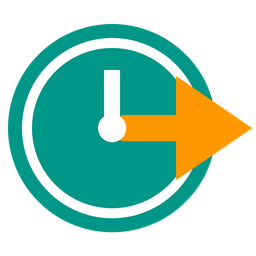
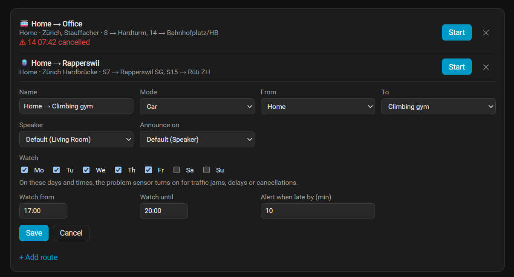
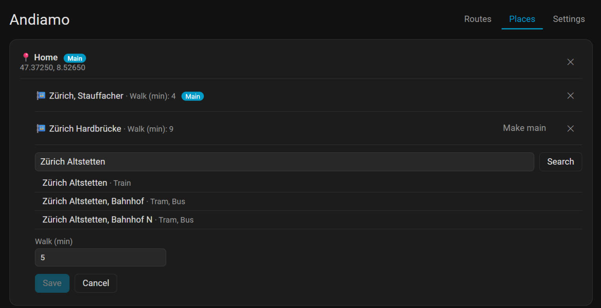
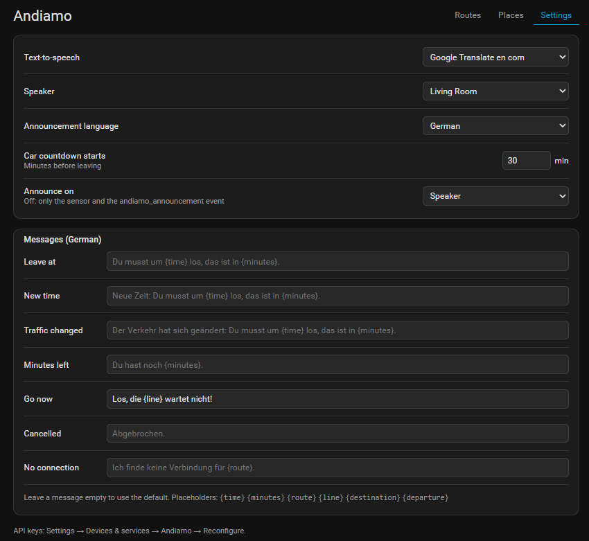
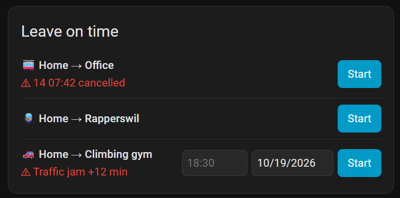

# Andiamo

**Never miss your train, bus or tram again, and stop checking the time while you get ready.**

Andiamo (Italian for *"let's go!"*) is a Home Assistant integration that tells you, out loud on your speaker, exactly when to leave the house: to catch your bus, tram or train, or to arrive somewhere by car on time.

- **Public transport (Switzerland):** press one button and your speaker says *"You need to leave at 10:15, that is in 7 minutes."*, then *"2 minutes left"* and *"Go now!"*. Andiamo knows how long you walk to your stop and which lines you take, follows real-time delays, and announces a new time if yours moves. Too late for the next train, bus or tram? It quietly picks the one after. Press again to cancel.
- **Car:** set "arrive by 19:00" on the dashboard card. From 30 minutes before you need to leave, the speaker counts down every 5 minutes (*"You have 25 minutes left"*) and ends with *"Go now!"*. Live traffic is followed all the way, so a jam on the way means an earlier "go".

Everything is set up on one sidebar page, no YAML. Announcements are in German (default) or English.

**Where it works:** car routes work anywhere TomTom has maps. Public transport uses Swiss data (opentransportdata.swiss), so it only covers Switzerland for now. Other free transport data providers can be added: [open an issue](https://github.com/geeForceOne/andiamo/issues) and say which one you'd like.

## Screenshots

**Routes:** one tap to start. The watchdog flags a cancelled tram; the open car route is watched on weekday evenings and alerts from 10 minutes of traffic.



**Places and stations:** each place has its stations with the walking time; the search shows what stops there, so the train station is easy to tell from the tram stop outside.



**Settings:** speaker, language, where announcements go, and your own announcement texts.



**Dashboard card:** start routes, set "arrive by" for the car, and see watchdog problems.



## What you need

- Home Assistant 2026.3 or newer.
- For public transport: a free API key from [opentransportdata.swiss](https://api-manager.opentransportdata.swiss/) (OJP 2.0).
- For the car: a free API key from [TomTom](https://developer.tomtom.com/) (Routing and Search).
- A text-to-speech entity (e.g. Google Translate, Piper) and a speaker (`media_player`).

## Install

Andiamo isn't in the default HACS list yet, so you add it to HACS as a custom repository first. It takes a minute.

**HACS, the quick way:** click this button. It opens HACS in your Home Assistant and asks to add Andiamo; click **Add**, then **Download**, and restart Home Assistant.

[](https://my.home-assistant.io/redirect/hacs_repository/?owner=geeForceOne&repository=andiamo&category=integration)

**HACS, by hand:**

1. In Home Assistant, open **HACS**, click **⋮** (top right) → **Custom repositories**.
2. Paste `https://github.com/geeForceOne/andiamo`, choose the type **Integration** and click **Add**.
3. Search HACS for **Andiamo**, open it and click **Download**.
4. Restart Home Assistant.

HACS then tells you about new versions like any other integration.

**Without HACS:** copy `custom_components/andiamo` into your `/config/custom_components/` folder and restart.

Then: Settings → Devices & services → Add integration → **Andiamo**, and enter one or both API keys. Change the keys later with **Reconfigure** on the integration.

## Set up

Open **Andiamo** in the sidebar.

1. **Places:** your home is there already as the main place. Add more places (e.g. *Office*, *Climbing gym*) by address search or coordinates.
2. **Stations:** under a place, search for a stop and set how many minutes you walk there. The first one is the main station; any station can be made main.
3. **Routes:** a public transport route boards at a station (the main one unless you pick another) and takes the lines you tick, e.g. *10 → Zürich Flughafen*; the form lists the lines leaving that station. A car route goes from one place to another, e.g. *Home → Climbing gym*. Every route announces on the speaker from Settings, unless you pick another one for it. A route can also be **watched** on chosen days and times (see below).
4. **Settings:** text-to-speech entity, speaker, language, when the car countdown starts, and **Announce on**: *Speaker*, *Notification* (good for testing) or *Off* (nothing is said; use the sensor and the event in your own automations). Each route can choose its own.

## Use

- Each public transport route gets a button entity, e.g. `button.andiamo_home_office`. Press it from a dashboard, or from a physical button with an automation:

  ```yaml
  triggers:
    - trigger: state
      entity_id: event.hallway_button_action
  actions:
    - action: button.press
      target:
        entity_id: button.andiamo_home_office
  ```

- Add the **Andiamo** card to a dashboard (`type: custom:andiamo-card`, optional `mode: car` or `transit`, `routes: [Home → Office]`, `title:`). It starts routes and sets "arrive by" (time and date, today unless you change it) for car routes.
- Each route has a sensor (`sensor.andiamo_…`) with the leave time while a countdown runs.
- Start and stop any route from automations and scripts with the `andiamo.start` and `andiamo.stop` actions, aimed at the route's sensor. Car routes need a time; the date is optional (today, or tomorrow if the time has passed). `speaker` announces on another speaker for this run only. Starting a route that is already running starts it over.

  ```yaml
  actions:
    - action: andiamo.start
      target:
        entity_id: sensor.andiamo_home_climbing_gym
      data:
        time: "18:30"
        date: "2026-10-24"
        speaker: media_player.kitchen
  ```

### Announcements as data

- The route's sensor keeps the last announcement in its `message` attribute (with `message_at`), also after "go now", e.g. to show it on a display.
- Every announcement is also fired as the event `andiamo_announcement`, whatever *Announce on* says:

  ```yaml
  triggers:
    - trigger: event
      event_type: andiamo_announcement
  actions:
    - action: notify.mobile_app_my_phone
      data:
        title: "{{ trigger.event.data.route }}"
        message: "{{ trigger.event.data.message }}"
  ```

### Watchdog

Give a route days and a time window (e.g. Monday to Friday, 06:30 to 08:00) and **Alert when late by** (default 15 minutes). In that window Andiamo checks the route every 5 minutes, even when you haven't started it, and turns on its problem sensor, e.g. `binary_sensor.andiamo_home_office_problem`:

- **Car:** when the traffic delay on the way reaches the limit.
- **Public transport:** when the next departure you can still catch on a ticked line is cancelled, or late by at least the limit.

Attributes: `reason` (`traffic`, `delayed` or `cancelled`), `delay_minutes`, and for public transport `line`, `line_destination`, `departure` and `station`. Andiamo doesn't announce problems itself; react to the sensor in an automation:

```yaml
triggers:
  - trigger: state
    entity_id: binary_sensor.andiamo_home_office_problem
    to: "on"
actions:
  - action: notify.mobile_app_my_phone
    data:
      message: >-
        {{ state_attr(trigger.entity_id, 'line') or 'Traffic' }}:
        {{ state_attr(trigger.entity_id, 'reason') }}
        +{{ state_attr(trigger.entity_id, 'delay_minutes') }} min
```

Each check of a car route uses one TomTom request, so a 90-minute window costs about 18 requests a day.

## Development

Tests run in Linux (WSL on Windows):

```bash
uv venv --python 3.14 ~/.venvs/andiamo
source ~/.venvs/andiamo/bin/activate
uv pip install -r requirements_test.txt
bash scripts/test.sh
```

## License

[MIT](LICENSE)
